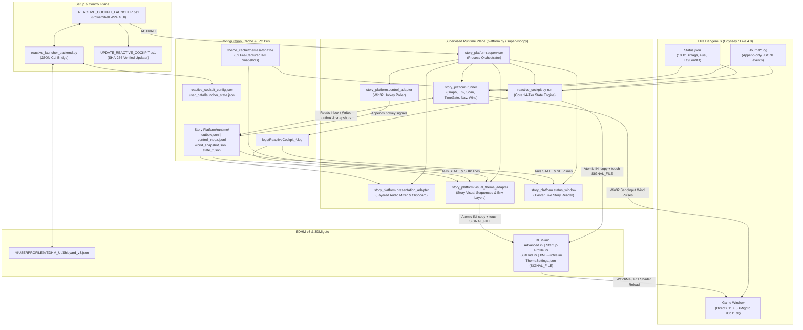

# Reactive Cockpit — System Architecture

This document describes the end-to-end architecture of **VRFlorian Reactive Cockpit**, covering its directory layout, multi-process runtime model, inter-process communication (IPC), and integration with **Elite Dangerous** and **EDHM (Elite Dangerous HUD Mod)**.

---

## 1. High-Level System Overview

Reactive Cockpit operates as an external companion layer between **Elite Dangerous** (which emits local telemetry via `Journal*.log` and `Status.json`) and **EDHM / 3DMigoto** (which renders custom DirectX 11 HUD shaders configured via `.ini` files in `EDHM-ini/`).



---

## 2. Repository & Directory Structure

```text
RC-KeppUpdated/
├── START VRFLORIAN REACTIVE COCKPIT.bat      # Root entry point -> launches PowerShell WPF GUI
├── README.txt / CHANGELOG.txt                # Player-facing release notes
├── README.md / CLAUDE.md / AGENTS.md         # Developer & AI documentation entry points
├── docs/                                     # Comprehensive technical & AI documentation
│   ├── ARCHITECTURE.md
│   ├── REACTIVE_ENGINE.md
│   ├── STORY_PLATFORM.md
│   ├── EDHM_INTEGRATION.md
│   ├── LAUNCHER_AND_PACKAGING.md
│   └── knowledge/                            # AI coding-agent playbooks & maintenance guides
├── .internal/                                # Developer reference data (not shipped in player zip)
│   ├── EDHM_reference/                       # Reference copy of EDHM GameDir (EDHM-ini, ShaderFixes) & UserDir
│   └── knowledge/                            # Shared Elite Dangerous verified facts (Journal, Status.json, APIs)
└── Reactive Cockpit Files/                   # Main application payload
    ├── REACTIVE_COCKPIT_LAUNCHER.ps1         # Native PowerShell + WPF Launcher UI (69 KB)
    ├── reactive_launcher_backend.py          # Python CLI backend called by the WPF launcher (17 KB)
    ├── reactive_cockpit.py                   # Core Reactive Cockpit engine & CLI tools (4,524 lines, 179 KB)
    ├── reactive_cockpit_config.json          # Per-ship assignments, thresholds, cooldowns, discovered paths
    ├── UPDATE_REACTIVE_COCKPIT.ps1           # Detached in-place updater with transactional rollback
    ├── update_config.json                    # Update channel, current version, and remote manifest URL
    ├── VALIDATE_CLEAN_PLAYER_BUILD.py        # Release preflight validator (59 themes, zero personal state)
    ├── PLAYER_BUILD.marker                   # Enforces local media paths & valid update packages
    ├── RUN_REACTIVE_COCKPIT_PLAYER.bat       # Supervised launch (media-check + Story Platform + Core)
    ├── RUN_REACTIVE_COCKPIT.bat              # Standalone core launch (reactive_cockpit.py run)
    ├── DIAGNOSTICS.bat                       # Prints live EDHM/Shipyard/Journal diagnostics
    ├── INSTALL_REACTIVE_COCKPIT.bat          # Interactive CLI package installer (community_install)
    ├── INSTALL_AND_CAPTURE.bat               # Interactive live EDHM theme capture wizard (setup)
    ├── bundled_edhm_themes/                  # 59 authored EDHM UI theme folders (ThemeSettings.json + JPGs)
    ├── bundled_theme_cache/                  # Master copy of 59 compiled INI snapshots + index.json
    ├── theme_cache/                          # Working runtime cache of 59 compiled INI snapshots + index.json
    ├── launcher_assets/                      # Launcher background images & launcher_music.mp3
    ├── user_data/                            # Protected user preferences (launcher_state.json, launcher_music.json)
    ├── logs/                                 # Rolling session logs (ReactiveCockpit_YYYY-MM-DD_HH-MM-SS.log, max 5)
    └── Story Platform/                       # Narrative & environmental platform subsystem (v0.12.6-LIVING-WORLD)
        ├── platform.py                       # CLI entry point (run, editor, validate, media-check, dev, dry-run)
        ├── platform_config.json              # Graph catalog, active_graph, hotkey controls, audio/window settings
        ├── schema/story_graph.schema.json    # JSON Schema for story graphs (platform.story-graph.v1)
        ├── stories/                          # Authored story graphs & Player Reader profiles
        │   ├── yggdrasil/graph.json          # Living World ambient graph (1,796 lines)
        │   ├── mission_01/graph.json         # Guardian Signal — Mission 1 (4,170 lines)
        │   └── mission_02/                   # The Secrets of Aiabiko — Mission 2 (4,450 lines + player_reader.json)
        ├── story_assets/                     # Local MP3/WAV audio assets for Living World, Mission 1, Mission 2
        ├── story_platform/                   # 29 Python modules (supervisor, runner, engine, environments, etc.)
        └── tests/                            # 8 unit test suites + telemetry fixtures
```

---

## 3. Process Architecture & Supervision

Reactive Cockpit deliberately separates its **Core HUD State Engine** from the **Story Platform** using OS process isolation rather than shared in-process threads.

### 3.1 Why Multi-Process Isolation?
1. **Fault Isolation:** Even if Story Mode is turned off or a story service restarts during a mission switch, [`reactive_cockpit.py`](file:///X:/Projects/EDProjects/RC_dev/Reactive%20Cockpit%20Files/reactive_cockpit.py) continues running uninterrupted so the player never loses reactive combat/danger HUD lighting.
2. **Zero External Python Dependencies:** Both `reactive_cockpit.py` and `story_platform` rely strictly on the Python 3.10+ standard library (`ctypes`, `tkinter`, `json`, `hashlib`, `subprocess`, `msvcrt`, `urllib`) plus Windows built-in PowerShell/.NET (`PresentationFramework`, `PresentationCore`) and `winmm.dll`.
3. **Single-Instance Locking ([`instance_lock.py`](file:///X:/Projects/EDProjects/RC_dev/Reactive%20Cockpit%20Files/Story%20Platform/story_platform/instance_lock.py#L11-L85)):**
   - Uses both a Win32 Named Mutex (`Local\ReactiveCockpitStoryPlatform_<scope_hash>_<name>`) and an `msvcrt.LK_NBLCK` byte lock on `Story Platform/.locks/<name>.lock`.
   - Acquired by `supervisor`, `graph` (`runner.py`), and `presentation` (`presentation_adapter.py`), and checked by `reactive_launcher_backend.py` before allowing mission switches or resets.

### 3.2 Supervised Process Tree (`supervisor.py`)
When launched via [`RUN_REACTIVE_COCKPIT_PLAYER.bat`](file:///X:/Projects/EDProjects/RC_dev/Reactive%20Cockpit%20Files/RUN_REACTIVE_COCKPIT_PLAYER.bat), [`story_platform/supervisor.py`](file:///X:/Projects/EDProjects/RC_dev/Reactive%20Cockpit%20Files/Story%20Platform/story_platform/supervisor.py#L58-L248) orchestrates up to 6 child processes:

| Process Key | Module / Command | Spawned When | Role |
| :--- | :--- | :--- | :--- |
| `core` | `reactive_cockpit.py run` | Always (unless `--story-only`) | 10 Hz Journal + `Status.json` poller, 14-tier ship HUD state machine, `CTRL+SHIFT+D` Disco Mode controller, session logger. |
| `presentation` | `-m story_platform.presentation_adapter` | Story Mode ON | Tails `runtime/outbox.jsonl`; manages `LayeredAudioMixer` (headless PowerShell WPF `MediaPlayer` child pipes + MCI fallback) and Win32 clipboard. Spawned **before** `graph` so its tail is armed at EOF. |
| `status_window` | `-m story_platform.status_window` | Story Mode ON | Always-on-top Tkinter **Live Story Reader** window (`300 ms` refresh). Restarts up to 3 times on crash; stays closed if user closes it (`exit 0`). |
| `graph` | `-m story_platform.runner` | Story Mode ON | Central story engine: `WorldModel`, Live Telemetry Gate, `GraphRuntime`, `EnvironmentRuntime`, `ScanRuntime`, `TimeGateRuntime`, `NavigationRuntime`, `WindRuntime`. |
| `controls` | `-m story_platform.control_adapter` | Story Mode ON | 30 ms Win32 `GetAsyncKeyState` hotkey poller (`CTRL+C`, `CTRL+A`, `CTRL+N`, `CTRL+S`, `CTRL+P`); writes to `runtime/control_inbox.jsonl`. |
| `visual_theme` | `-m story_platform.visual_theme_adapter` | Story Mode ON | Tails `runtime/outbox.jsonl` and `logs/ReactiveCockpit_*.log`; applies story visual sequences & environment layers to `EDHM-ini` while yielding to higher-priority core states and Disco Mode. |

### 3.3 Dynamic Story Mode Toggling & Graph Switching
- **Live Story Mode Toggle:** [`supervisor.py`](file:///X:/Projects/EDProjects/RC_dev/Reactive%20Cockpit%20Files/Story%20Platform/story_platform/supervisor.py#L159-L166) polls [`user_data/launcher_state.json`](file:///X:/Projects/EDProjects/RC_dev/Reactive%20Cockpit%20Files/user_data/launcher_state.json) every `0.35s`. Toggling `story_mode_enabled` starts or stops the 5 story processes while keeping `core` alive.
- **Hot Graph Switching (Exit Code `75`):** When a story graph emits a `switch_graph` action, [`runner.py`](file:///X:/Projects/EDProjects/RC_dev/Reactive%20Cockpit%20Files/Story%20Platform/story_platform/runner.py#L158-L191) updates `platform_config.json` and exits with `GRAPH_SWITCH_EXIT_CODE = 75`. The supervisor catches exit code `75` (rate-limited to 8 switches/minute) and cleanly restarts `presentation`, `graph`, and `visual_theme` on the new graph.

---

## 4. Inter-Process Communication (IPC) & Synchronization

All cross-process communication uses atomic files and append-only JSONL streams on disk:

| File / Stream | Producer(s) | Consumer(s) | Semantics |
| :--- | :--- | :--- | :--- |
| `Story Platform/runtime/outbox.jsonl` | `runner.py`, `developer.py`, `editor_model.py` | `presentation_adapter.py`, `visual_theme_adapter.py` | Append-only JSONL bus for audio layer commands (`play_layer`, `set_layer_volume`, `stop_layer`, `set_audio_gate`), visual sequences/layers, clipboard, and log messages. |
| `Story Platform/runtime/control_inbox.jsonl` | `control_adapter.py`, `presentation_adapter.py`, `developer.py` | `runner.py` | Append-only JSONL bus for player hotkeys (`control.*`), audio completion signals (`completion_signal`, `presentation.scanner_startup_complete`), and dev signal injections. |
| `Story Platform/runtime/world_snapshot.json` | `runner.py` | `visual_theme_adapter.py`, `player_reader.py`, `graph_editor.py` | Atomic JSON snapshot of `WorldModel` (`location`, `flags`, `vehicle`, `navigation`, `time`, `scans`, `live_audio_gate`). |
| `Story Platform/runtime/wind_status.json` | `wind_runtime.py` | `player_reader.py` | Atomic JSON snapshot of active planetary wind state and dynamic landing window countdown clues. |
| `Reactive Cockpit Files/runtime/disco_mode.active` | `reactive_cockpit.py` | `visual_theme_adapter.py`, `VALIDATE_CLEAN_PLAYER_BUILD.py` | Atomic marker file created when Disco Mode (`CTRL+SHIFT+D`) is active; instructs `VisualThemeAdapter` to pause EDHM writes while expiring visual sequence timers in the background. |
| `Reactive Cockpit Files/logs/ReactiveCockpit_*.log` | `reactive_cockpit.py` (`TeeStream`) | `visual_theme_adapter.py`, `player_reader.py` | Tailed to observe the core engine's live ship match (`Current ship ->`, `SHIP ->`) and active reactive state (`STATE -> <STATE>  |  <theme>`). |
| `EDHM-ini/*.ini` & `ThemeSettings.json` | `reactive_cockpit.py`, `visual_theme_adapter.py` | EDHM UI (`WatchMe`) / 3DMigoto (`d3d11.dll`) | Written via PID-namespaced temporary files (`.reactive_cockpit_tmp`, `.disco_<pid>.tmp`, `.story_visual_<pid>_<ns>.tmp`) + `os.replace()`, followed by a `60 ms` settle delay and touching `ThemeSettings.json`. |
