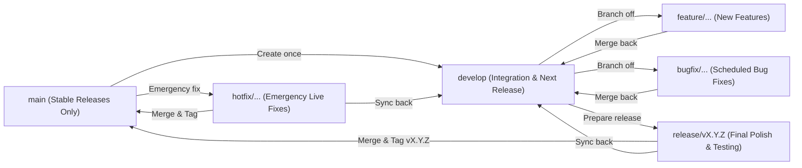

# GitFlow Ruleset & Beginner-Friendly Workflow Guide

> **Beginner-Friendly & Mandatory Project Standard**
> Whether you are brand new to Git/GitHub or an experienced developer/AI coding assistant, this guide explains step-by-step how branches, commits, versions, bugfixes, and merges work in the **Reactive Cockpit** repository.

---

## 1. Strict Author & Attribution Rule (MANDATORY)

> [!CAUTION]
> **NEVER** add AI or external co-author trailers (`Co-authored-by: Antigravity`, `Co-authored-by: Gemini`, `Co-authored-by: Claude`, `Co-authored-by: Copilot`, etc.) to any commit message, pull request, or GitHub Action.

All commits and Git/GitHub actions in this repository **MUST** use **only** the repository owner's identity:

- **Author Name:** `Dreak183`
- **Author Email:** `55458977+Dreak183@users.noreply.github.com`

### How to verify or set this locally (run once in your terminal):
```powershell
git config user.name "Dreak183"
git config user.email "55458977+Dreak183@users.noreply.github.com"
```

---

## 2. What is GitFlow? (Explained Simply for Beginners)

Think of **GitFlow** like railway tracks that keep unstable work-in-progress separate from the stable version players download:



### The Two Permanent Branches
1. **`main` (Production / Stable Branch)**
   - Contains **only** tested, clean, release-ready code (`VALIDATE_CLEAN_PLAYER_BUILD.py` must pass).
   - Every merge into `main` represents an official version (tagged `vX.Y.Z`).
   - **Rule:** Never commit directly to `main`.
2. **`develop` (Integration / Working Branch)**
   - The main hub where all finished features and bugfixes come together before a release.
   - All new `feature/` and `bugfix/` branches start from `develop` and merge back into `develop`.
   - **Rule:** Never commit messy work directly to `develop`—always create a short-lived branch first.

---

## 3. Branch Naming Ruleset

Always use lowercase letters, numbers, and hyphens (`kebab-case`) after the prefix slash `/`. If a GitHub Issue exists (e.g., Issue `#3`), include `issue-3` right after the slash!

| Branch Type | Naming Pattern | Branch From | Merge Into | When to Use |
| :--- | :--- | :--- | :--- | :--- |
| **Feature** | `feature/issue-<nr>-<short-slug>` or `feature/<short-slug>` | `develop` | `develop` | Adding a new ship cockpit package, story mission, UI capability, or telemetry trigger. |
| **Bugfix** | `bugfix/issue-<nr>-<short-slug>` or `bugfix/<short-slug>` | `develop` | `develop` | Fixing a bug found during development or listed in GitHub Issues (non-emergency). |
| **Release** | `release/v<MAJOR>.<MINOR>.<PATCH>` | `develop` | `main` **and** `develop` | Freezing features to run final verification, bump version numbers, and package a release. |
| **Hotfix** | `hotfix/v<MAJOR>.<MINOR>.<PATCH>-<short-slug>` | `main` | `main` **and** `develop` | Fixing a critical crash or blocker discovered in the already-released `main` branch. |
| **Docs / Chore** | `docs/<short-slug>` or `chore/<short-slug>` | `develop` | `develop` | Updating documentation, rules, or build scripts without changing runtime behavior. |

### Examples of Good Branch Names
- `bugfix/issue-3-odyssey-repair-items-list`
- `bugfix/issue-4-audio-player-mci-close-status`
- `bugfix/issue-5-story-graph-schema-drift`
- `bugfix/issue-6-story-visual-layer-down-transition`
- `bugfix/issue-7-journal-sorting-and-partial-line-flush`
- `feature/issue-12-anaconda-stealth-shader`
- `release/v2.3.0`
- `hotfix/v2.2.12-canopy-breach-crash`

---

## 4. Versioning Rules (`MAJOR.MINOR.PATCH`)

We follow **Semantic Versioning (SemVer)**: `vMAJOR.MINOR.PATCH` (for example `v2.2.11`):

1. **MAJOR (`X.0.0`) — Big / Breaking Overhauls**
   - Increment when making incompatible changes to config schemas, major architectural rewrites, or new Elite Dangerous expansion compatibility.
2. **MINOR (`2.X.0`) — New Features (Backwards-Compatible)**
   - Increment when adding new ship packages, new story missions, new reactive state slots, or new launcher capabilities. Reset `PATCH` to `0`.
3. **PATCH (`2.2.X`) — Bugfixes & Hardening Only**
   - Increment when fixing bugs, edge cases, schema drift, or build hygiene without adding new features.

---

## 5. Step-by-Step Cookbook for Common Tasks

### Scenario A: Fixing a Bug for a GitHub Issue (Standard `bugfix/` Flow)

Suppose you want to fix **Issue #3** (`Odyssey Repair Event Uses "Items" List`):

```powershell
# Step 1: Switch to 'develop' and get the latest changes from GitHub
git checkout develop
git pull origin develop

# Step 2: Create and switch to a new bugfix branch named after the issue
git checkout -b bugfix/issue-3-odyssey-repair-items-list

# Step 3: Edit the code, write/run tests, and run the Verification Suite
py -3 "Reactive Cockpit Files\reactive_cockpit.py" selftest
Push-Location "Reactive Cockpit Files\Story Platform"; py -3 -m unittest discover -s tests; Pop-Location
py -3 "Reactive Cockpit Files\Story Platform\platform.py" validate
py -3 "Reactive Cockpit Files\VALIDATE_CLEAN_PLAYER_BUILD.py"

# Step 4: Stage your changed files
git add "Reactive Cockpit Files/reactive_cockpit.py"

# Step 5: Commit using ONLY Dreak183 as author (reference "Fixes #3" to auto-link the issue)
git commit -m "fix(cockpit): support Odyssey Repair Items list in hull/canopy restoration (Fixes #3)"

# Step 6: Push the branch to GitHub (optional if merging locally first)
git push -u origin bugfix/issue-3-odyssey-repair-items-list
```

### Scenario B: Merging a Finished `bugfix/` or `feature/` Branch into `develop`

Always use **`--no-ff` (no fast-forward)** when merging into `develop` or `main`. Why? Because `--no-ff` preserves a clear historical record showing that a group of commits belonged to a specific issue or feature branch!

```powershell
# Step 1: Switch back to 'develop'
git checkout develop

# Step 2: Merge the bugfix branch with --no-ff
git merge --no-ff bugfix/issue-3-odyssey-repair-items-list -m "Merge branch 'bugfix/issue-3-odyssey-repair-items-list' into develop (Fixes #3)"

# Step 3: Push updated 'develop' to GitHub
git push origin develop
```

### Scenario C: Creating an Official Release (`release/vX.Y.Z`)

When `develop` has all the bugfixes/features you want to ship to players:

```powershell
# Step 1: Create the release branch from 'develop'
git checkout develop
git checkout -b release/v2.2.12

# Step 2: Run the Clean Player Build validator (MUST PASS!)
py -3 "Reactive Cockpit Files\VALIDATE_CLEAN_PLAYER_BUILD.py"

# Step 3: Merge into 'main' and tag the version
git checkout main
git merge --no-ff release/v2.2.12 -m "Release v2.2.12"
git tag -a v2.2.12 -m "Release v2.2.12"

# Step 4: Merge back into 'develop' so 'develop' has the exact release state
git checkout develop
git merge --no-ff release/v2.2.12 -m "Merge release/v2.2.12 back into develop"

# Step 5: Push 'main', 'develop', and tags to GitHub
git push origin main develop --tags
```

### Scenario D: Emergency Fix on Live Production (`hotfix/vX.Y.Z-...`)

If `main` has a critical bug and `develop` already has unfinished next-version work:

```powershell
# Step 1: Branch directly off 'main'
git checkout main
git checkout -b hotfix/v2.2.13-critical-fix

# Step 2: Fix, test, and commit
git add .
git commit -m "fix: resolve critical startup crash"

# Step 3: Merge into 'main' and tag
git checkout main
git merge --no-ff hotfix/v2.2.13-critical-fix -m "Hotfix Release v2.2.13"
git tag -a v2.2.13 -m "Hotfix v2.2.13"

# Step 4: Also merge into 'develop' so the bug stays fixed in future releases!
git checkout develop
git merge --no-ff hotfix/v2.2.13-critical-fix -m "Merge hotfix/v2.2.13-critical-fix into develop"
```

---

## 6. Commit Message Format (Conventional Commits)

Keep commit messages short, clear, and structured:

```text
<type>(<scope>): <short summary in present tense> (#<issue-number>)
```

- **Allowed `<type>` values:**
  - `fix`: Bug fix (`fix(cockpit): ...`, `fix(audio): ...`, `fix(schema): ...`)
  - `feat`: New feature (`feat(packages): ...`, `feat(story): ...`)
  - `docs`: Documentation or rules update (`docs(gitflow): ...`)
  - `test`: Adding or updating unit/self tests (`test(story): ...`)
  - `chore`: Build hygiene, config cleanup, packaging (`chore(build): ...`)
  - `refactor`: Code restructuring without behavior change
- **Linking Issues Automatically:**
  - Including `Fixes #3` or `Closes #3` in the commit message or PR description automatically closes Issue `#3` on GitHub when merged into the default branch.
- **Forbidden Trailers:**
  - **Never** include `Co-authored-by:` for any AI agent or third-party assistant.
